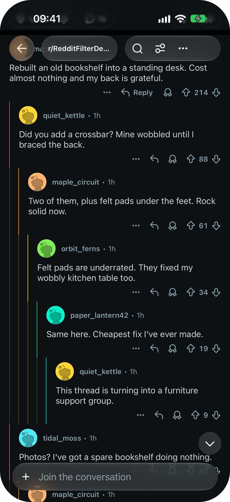
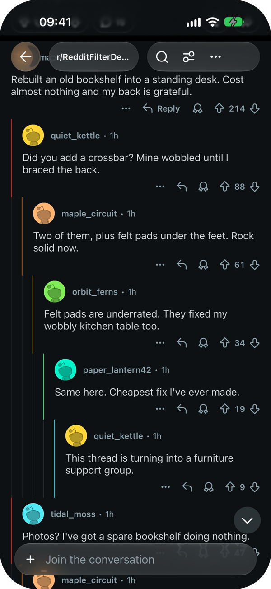
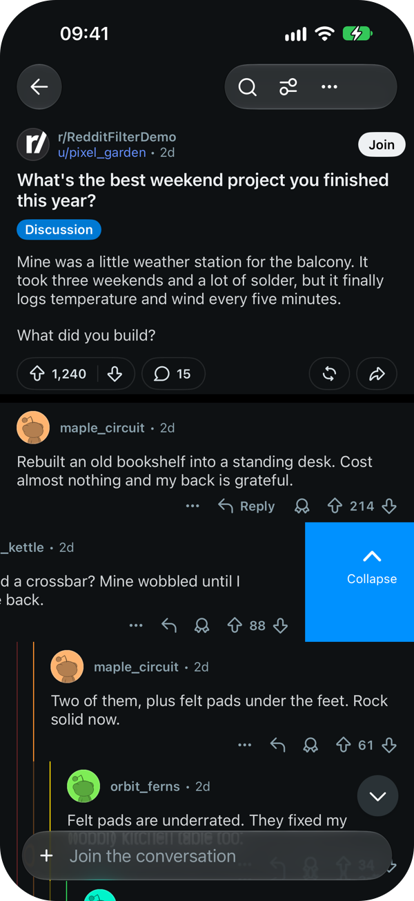
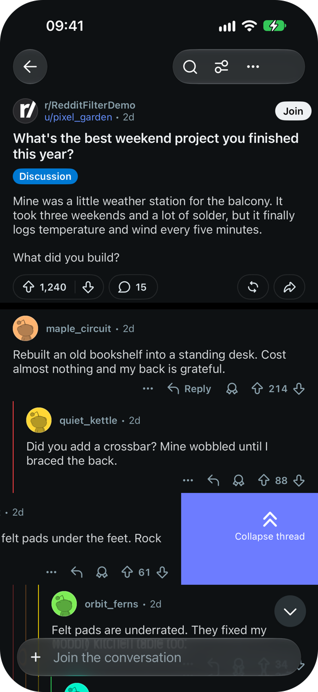
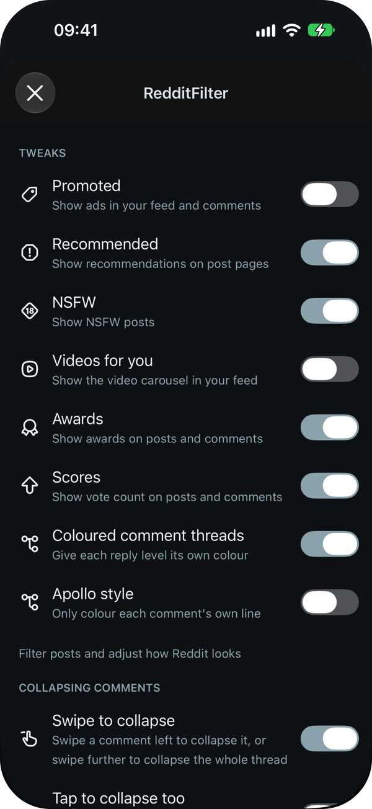
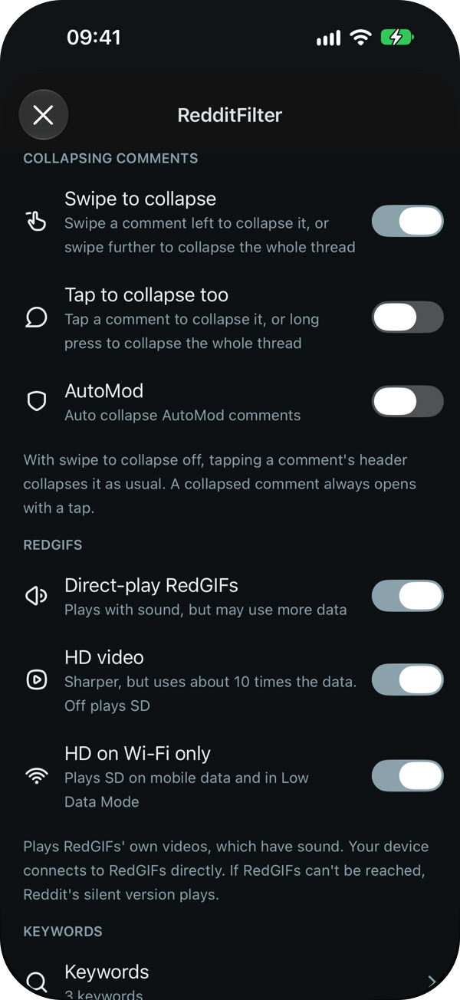
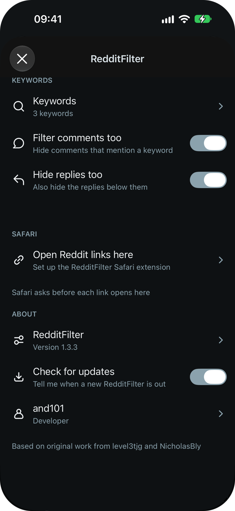
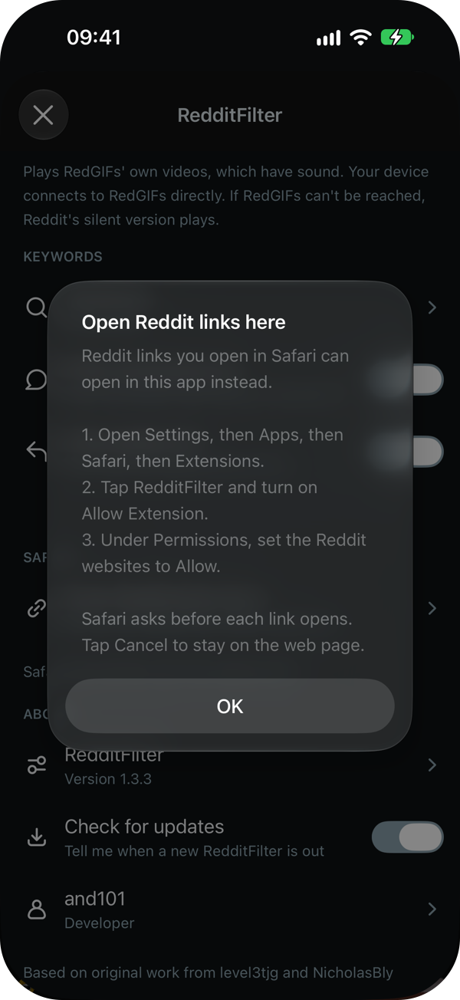

# RedditFilter

Filters unwanted content from the Reddit app: promoted posts, recommendations, NSFW posts, awards, scores, and posts or comments that mention your keywords. It can also play RedGIFs videos with sound, collapse comments with a swipe and open Reddit links from Safari in the app.

<table>
  <tr>
    <th colspan="2">Coloured comment threads</th>
    <th colspan="2">Swipe to collapse</th>
  </tr>
  <tr>
    <td align="center" width="25%"></td>
    <td align="center" width="25%"></td>
    <td align="center" width="25%"></td>
    <td align="center" width="25%"></td>
  </tr>
  <tr>
    <td align="center"><b>Default</b><br><sub>Parent lines faded</sub></td>
    <td align="center"><b>Apollo style</b><br><sub>Only each comment's own line</sub></td>
    <td align="center"><b>Swipe left</b><br><sub>Collapses the comment and its replies</sub></td>
    <td align="center"><b>Swipe further</b><br><sub>Collapses the whole thread</sub></td>
  </tr>
  <tr>
    <th colspan="3">Settings</th>
    <th>Safari</th>
  </tr>
  <tr>
    <td align="center" width="25%"></td>
    <td align="center" width="25%"></td>
    <td align="center" width="25%"></td>
    <td align="center" width="25%"></td>
  </tr>
  <tr>
    <td align="center"><b>Tweaks</b><br><sub>Show or hide each kind of content</sub></td>
    <td align="center"><b>Collapsing and RedGIFs</b><br><sub>Swipe or tap, and video quality</sub></td>
    <td align="center"><b>Keywords and About</b><br><sub>Keyword filters, Safari and update check</sub></td>
    <td align="center"><b>Open Reddit links here</b><br><sub>Set up the Safari extension</sub></td>
  </tr>
</table>

<sub>Screenshots use a made-up community, post and users.</sub>

## New in 1.3.3

- **Swipe to collapse**: swipe a comment left to collapse it and its replies, or swipe further to collapse the whole thread, like the 2024 app. The comment slides with your finger and shows what will happen. Swiping left on a collapsed comment or on the post still moves to the next post, and swiping right still goes back. Off by default; turn it on under **Collapsing comments**.
- **Collapsing comments settings**: a new section for **Swipe to collapse**, **Tap to collapse too** and the **AutoMod** switch. With swipe on, a tap or long press on a comment no longer collapses it, so it can't happen by accident. Turn on **Tap to collapse too** to keep both. A collapsed comment always opens with a tap.
- **Open Reddit links in the app**: a Safari extension now opens Reddit links from Safari in RedditFilter. Safari asks before each one. To set it up, tap **Open Reddit links here** in the new **Safari** section of RedditFilter settings.
- **RedGIFs quality**: RedGIFs has its own settings section, with **HD video** (off by default, so videos play in SD and use less data) and **HD on Wi-Fi only**, which plays SD on mobile data and in Low Data Mode.
- **Fixes**: ads no longer appear on the Home feed for users in a Reddit experiment that loads it differently. The IPA no longer includes Reddit's crash report extension, so SideStore and AltStore can install it.

## New in 1.3.2

- **Coloured comment threads**: new option that gives each reply level's thread line its own colour. Each comment's own line is in full colour and the lines of the comments above it are faded. Turn on **Apollo style** to colour only each comment's own line. Off by default. Lines Reddit already colours, like a highlighted comment's, keep their colour.
- **Update check**: once a day, RedditFilter checks GitHub for a new release and shows an alert once for each one. That includes the same RedditFilter version rebuilt for a newer Reddit version. RedditFilter settings also show when an update is available. Turn it off with **Check for updates** under About.
- **Redesigned settings**: RedditFilter settings now look like Reddit's current Settings and follow its theme colours. They open in their own sheet with a close button. **Filters** is now called **Tweaks**. Section headers and footers grow with your text size.
- **Fixes**: icons no longer disappear from settings rows. A highlighted comment's gold line no longer shifts the thread colours.

## New in 1.3.1

- **Ads and filters came back for some users**: Reddit is moving some users to a new server address, and RedditFilter didn't filter anything coming from it. Ads, keywords and every other filter now work on both.
- **Feeds don't wait long for extra checks**: if the full-text keyword check or the extra page loaded for a short For You feed is slow, the page now appears after at most 5 seconds instead of waiting for it. With RedGIFs direct-play on, RedGIFs videos and the full-text check now load at the same time.
- **Keywords ignore link addresses**: a keyword only matches the visible text of a link, not the address it points to.
- **Full-text check after a Reddit update**: after you update Reddit, RedditFilter no longer reuses the request it saved from the previous version.
- **RedGIFs**: videos loading at the same time now share one RedGIFs sign-in instead of each asking for their own.
- **Sideloaded installs**: fixed a crash at launch when the app couldn't read its keychain settings, and a memory leak in keychain access.

## New in 1.3.0

- **Keywords check the whole post**: posts are hidden when a keyword appears anywhere in their text, not just in the title or the preview shown in the feed. Feed cards that show the whole post are now checked too. With keywords set, checking full text adds one batch request per feed page before it appears. If that request fails, title and preview filtering still apply.
- **Filter comments too**: new option under Keywords to hide comments that mention a keyword. Their replies are hidden as well, unless you turn off **Hide replies too**: then the comment is replaced by a "Hidden by keyword filter" placeholder and its replies stay.
- **Direct-play RedGIFs**: new option to play RedGIFs videos with sound. Reddit's copies of RedGIFs videos have no audio, so RedditFilter plays the original from RedGIFs instead, in posts and in the feed. It may use more data, and your device connects to RedGIFs directly. If RedGIFs can't be reached, Reddit's silent version plays as before.
- **Clearer settings**: every switch now says what it does. The **Promoted**, **Recommended** and **NSFW** switches show that content when on; turn **Promoted** off to hide ads. Icons are aligned and follow your light or dark theme.

## Fixes for Reddit 2026.43.0

- **Comment ads** are hidden again.
- **NSFW filter** now hides NSFW posts in the new feed cards and in community highlights.
- **Recommended filter** no longer empties the For You feed, which is now mostly recommendations (your subscriptions are in Following). It still removes the "Related answers" section on post pages.
- **Videos for you**: new option to hide the "Videos for you" carousel in your feed.
- **For You** no longer stops after a few posts when hidden posts leave the first page too short to scroll.
- **Keywords**: new option to hide posts that mention a word or phrase. In RedditFilter settings, tap **Keywords** to add them (separate several with commas). Swipe a keyword to remove it, or use **Clear All Keywords**. Matching is whole-word and ignores capitals.
- **RedditFilter settings** are back: Profile → Settings, button at the top right.
- **Logging in** now works on sideloaded installs (see below).

## Logging in

Reddit rejects the app's normal username and password login when the app is sideloaded. Use one of these instead:

1. Open the login screen: **I already have an account** (or **Log in**) → **Use email or username**. To add another account, open the account switcher → **Add account** → **Log in**.
2. Tap **Other options** at the top right, then choose:
   - **Log in with browser**: log in on the reddit.com page that opens, including any 2FA code. The app finishes logging in by itself.
   - **Open login link**: first tap **Email me a login link instead**, then copy the link from Reddit's email and paste it here.

Google sign-in may not work inside the browser, because Google often blocks it in apps. Use your Reddit username and password on the web page instead.

## Install

Download the IPA from [Releases](../../releases), sign it with your usual signer and install it.

## Build

On a Mac with Xcode and [Homebrew](https://brew.sh):

```sh
git clone --recursive https://github.com/and101/RedditFilter.git
cd RedditFilter
./build-ipa.sh /path/to/decrypted-Reddit.ipa
```

The IPA is saved in `packages/`, unsigned. The script installs anything missing (Theos, theos-jailed, insert_dylib and a few Homebrew packages) at the versions used for the released IPAs, so builds match. The Reddit IPA must be decrypted.

For jailbroken devices, `make package` builds a deb (add `THEOS_PACKAGE_SCHEME=rootless` for rootless).

## Credits

Based on original work from [level3tjg](https://github.com/level3tjg/RedditFilter) and [NicholasBly](https://github.com/NicholasBly/RedditFilter).
